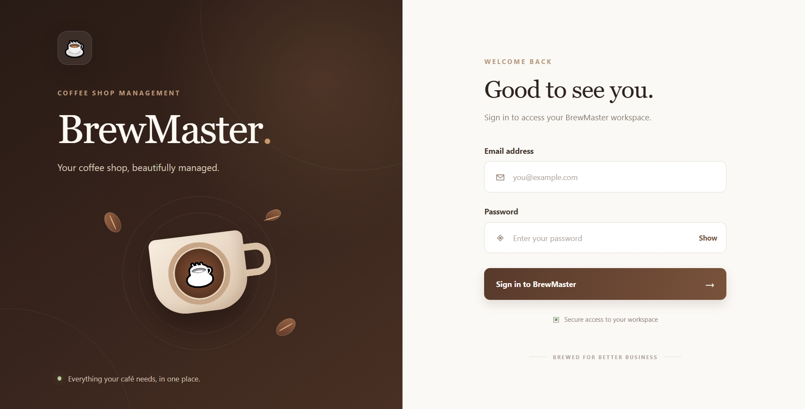
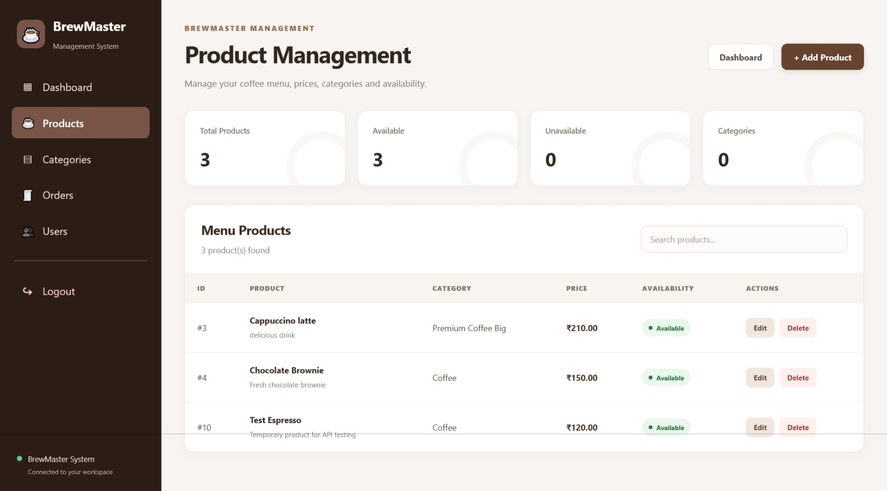
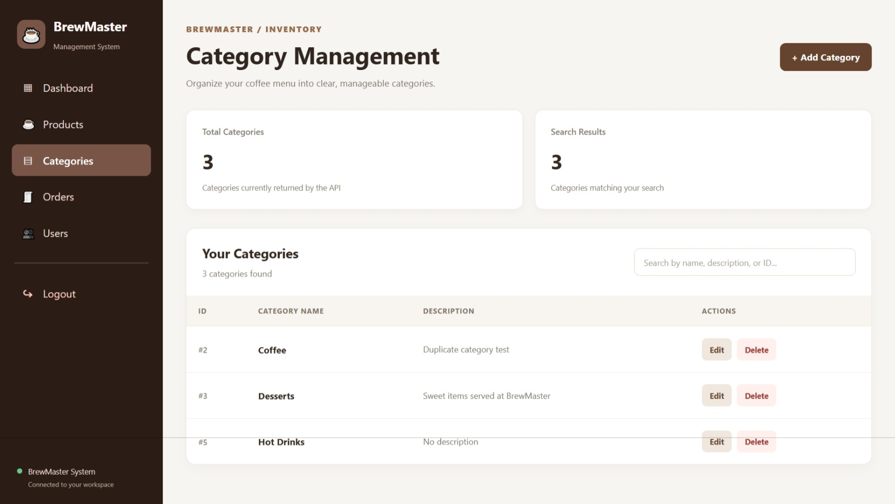
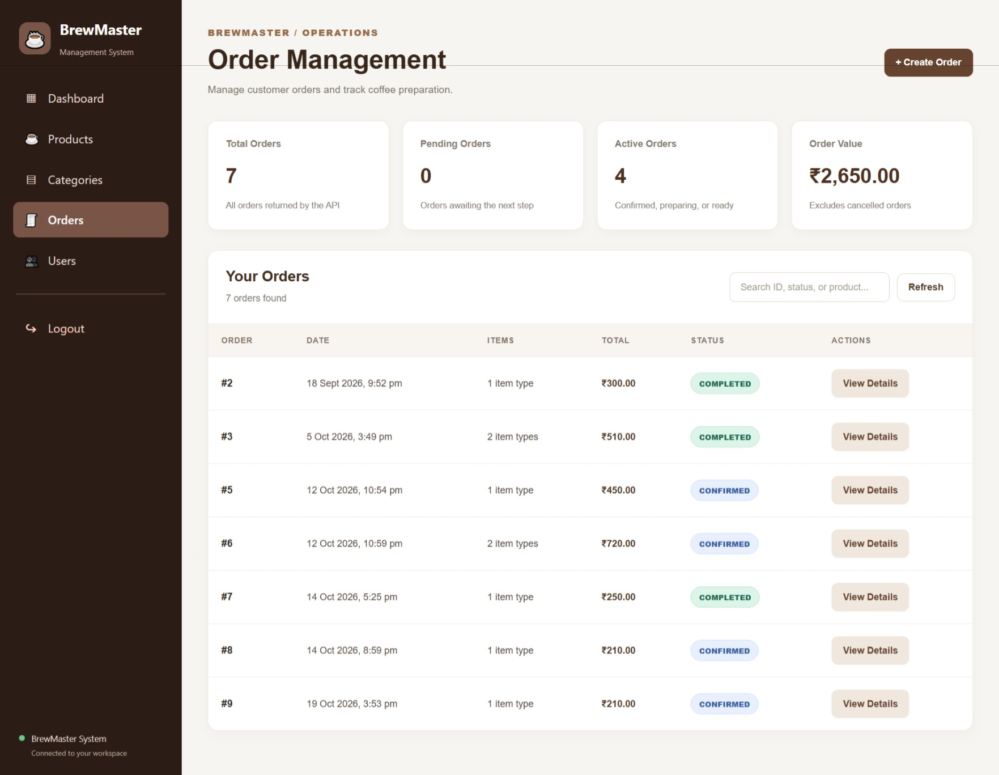
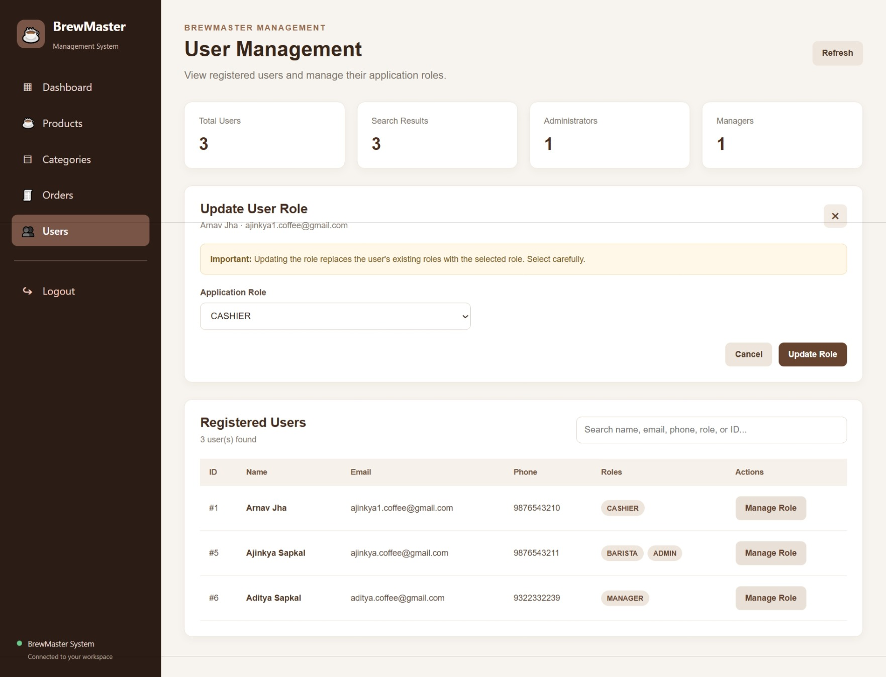
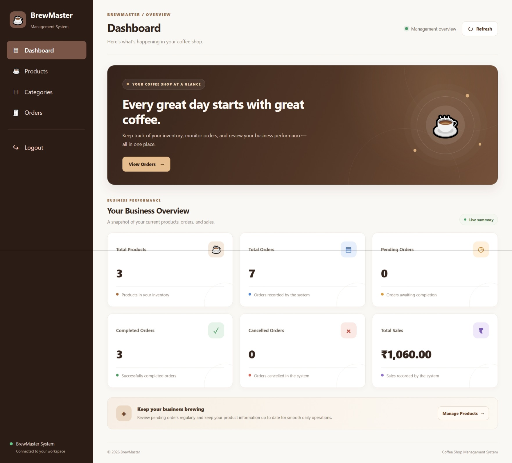
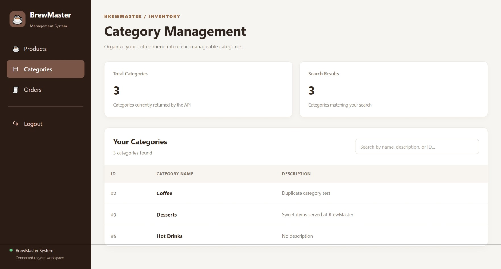
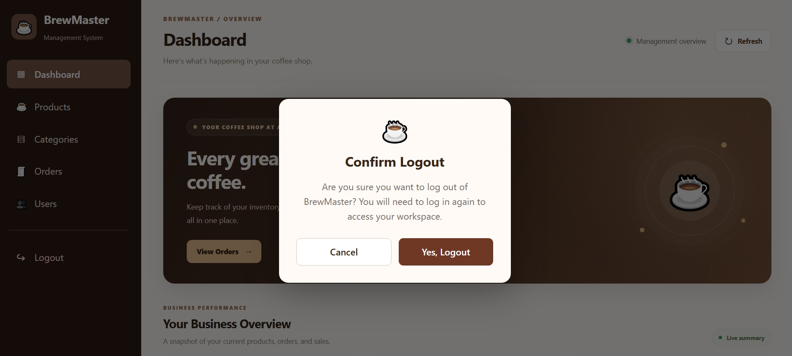

# BrewMaster — Coffee Shop Management System

A full-stack coffee shop management platform built with **Java 21, Spring Boot, Spring Security, React, and MySQL**. BrewMaster provides role-based access to product management, category management, order processing, user administration, and business dashboard operations.

The application follows a layered backend architecture and uses JWT authentication to secure REST APIs and enforce permissions across four operational roles.

---

## Project Overview

BrewMaster is designed to simplify coffee shop operations through a centralized management application.

It provides separate access permissions for:

- **ADMIN** — Manages users, products, categories, orders, and administrative operations.
- **MANAGER** — Manages categories and orders and accesses business dashboard information.
- **CASHIER** — Handles order creation and sales-related operations.
- **BARISTA** — Accesses order information and performs permitted order status updates.

The backend is responsible for authentication, authorization, business logic, validation, and database operations.

---

## Key Features

### 1. Authentication and Security

- User registration and login.
- JWT-based authentication.
- BCrypt password hashing.
- Stateless Spring Security configuration.
- Role-based endpoint authorization.
- Protected REST APIs.
- Token-based frontend authentication.

### 2. User Management

- Retrieve registered users.
- Manage user roles.
- Restrict administrative user operations to ADMIN.
- Support four operational roles.

### 3. Product Management

- Create products.
- Retrieve product information.
- Update existing products.
- Soft-delete products.
- Search products by name.
- Filter products by category and availability.
- Pagination and sorting support.
- Exclude deleted products from normal product listings.

### 4. Category Management

- Create categories.
- Retrieve categories.
- Update category information.
- Manage category availability.
- Restrict category operations according to user roles.

### 5. Order Management

- Create orders containing multiple products.
- Validate product availability.
- Calculate order totals using stored product prices.
- Retrieve order information.
- Filter orders by status.
- Update order statuses.
- Soft-delete orders.
- Use transactional operations for order processing.

### 6. Business Dashboard

- Business summary information.
- Sales-related statistics.
- Order and product summaries.
- Dashboard access for authorized administrators and managers.

### 7. API Documentation

- Swagger UI integration.
- OpenAPI documentation.
- Documented REST endpoints.
- JWT Bearer authentication support for secured API testing.

### 8. Backend Architecture

- Controller-Service-Repository architecture.
- DTO-based request and response handling.
- MapStruct-based object mapping.
- Centralized exception handling.
- Jakarta Bean Validation.
- JPA entity relationships.
- Transaction management.
- Optimistic locking through `@Version` in the base entity.

---

## Technology Stack

| Category | Technologies |
|---|---|
| Programming Language | Java 21 |
| Backend Framework | Spring Boot 3.5.4 |
| REST APIs | Spring Web |
| Security | Spring Security |
| Authentication | JWT (JJWT), BCrypt |
| ORM | Hibernate |
| Persistence | Spring Data JPA |
| Database | MySQL |
| Frontend | React 19 |
| Routing | React Router |
| HTTP Client | Axios |
| Frontend Build Tool | Vite |
| Validation | Jakarta Bean Validation |
| API Documentation | Swagger / OpenAPI |
| Object Mapping | MapStruct |
| Build Tool | Maven |
| Testing | JUnit 5, Spring Boot Test, Spring Security Test |

---

## Application Architecture

BrewMaster follows a layered architecture that separates frontend presentation, backend business logic, security, and database operations.

```text
                 React Frontend
                   (Vite)
                     |
                     | HTTP / JSON
                     | JWT Bearer Token
                     |
                     v
              Spring Boot REST API
                     |
              Spring Security
                     |
              JWT Authentication
                     |
                     v
                  Controllers
                     |
                     v
                   Services
                     |
                     v
                 Repositories
                     |
                     v
                Spring Data JPA
                     |
                     v
                   MySQL
```

### Backend Architecture Layers

| Layer | Responsibility |
|---|---|
| Controller | Handles HTTP requests and responses |
| Service | Implements application business logic |
| Repository | Performs database operations |
| Entity | Represents database tables |
| DTO | Transfers request and response data |
| Mapper | Converts entities and DTOs |
| Security | Handles authentication and authorization |
| Exception | Provides centralized error handling |
| Config | Contains application and API configuration |

---

## Role-Based Access Control

BrewMaster uses four roles to control access to application functionality.

| Feature | ADMIN | MANAGER | CASHIER | BARISTA |
|---|:---:|:---:|:---:|:---:|
| Login | Yes | Yes | Yes | Yes |
| View Products | Yes | Yes | Yes | Yes |
| Manage Products | Yes | No | No | No |
| View Categories | Yes | Yes | Yes | Yes |
| Manage Categories | Yes | Yes | No | No |
| View Orders | Yes | Yes | Yes | Yes |
| Create Orders | Yes | Yes | Yes | No |
| Update Order Status | Yes | Yes | No | Yes |
| Delete Orders | Yes | Yes | No | No |
| Manage Users and Roles | Yes | No | No | No |
| Business Dashboard | Yes | Yes | No | No |

Authorization is enforced at the backend level using Spring Security and role-based access rules. Frontend controls provide an additional role-aware user experience.

---

## Project Structure

```text
brewmaster/
│
├── src/
│   ├── main/
│   │   ├── java/com/brewmaster/
│   │   │   ├── config/
│   │   │   ├── controller/
│   │   │   ├── dto/
│   │   │   │   ├── request/
│   │   │   │   └── response/
│   │   │   ├── entity/
│   │   │   ├── enums/
│   │   │   ├── exception/
│   │   │   ├── mapper/
│   │   │   ├── repository/
│   │   │   ├── security/
│   │   │   │   ├── config/
│   │   │   │   ├── filter/
│   │   │   │   └── jwt/
│   │   │   └── service/
│   │   │       ├── interfaces/
│   │   │       └── impl/
│   │   │
│   │   └── resources/
│   │       ├── application.yaml
│   │       ├── application-dev.yaml
│   │       └── application-prod.yaml
│   │
│   └── test/
│
├── frontend/
│   ├── src/
│   ├── public/
│   ├── package.json
│   ├── vite.config.js
│   └── .env.example
│
├── .mvn/
├── mvnw
├── mvnw.cmd
├── pom.xml
├── .gitignore
└── README.md
```

---

## Getting Started

Follow these instructions to run BrewMaster locally.

### Prerequisites

Install the following:

- Java Development Kit (JDK) 21
- MySQL 8.x
- Node.js 20.19+ or 22.12+
- npm
- Git

### 1. Clone the Repository

```bash
git clone https://github.com/YOUR_GITHUB_USERNAME/YOUR_BREWMASTER_REPOSITORY.git
```

Open the project in IntelliJ IDEA.

Replace the example repository address with your actual GitHub repository address.

### 2. Create the MySQL Database

Open MySQL Workbench or your MySQL client and execute:

```sql
CREATE DATABASE brewmaster_db;
```

### 3. Configure Backend Environment

The default Spring profile is `dev`.

Backend configuration is maintained in:

```text
src/main/resources/application-dev.yaml
```

The application supports the following environment variables:

| Variable | Purpose |
|---|---|
| `SERVER_PORT` | Backend server port |
| `BREWMASTER_DB_URL` | MySQL JDBC connection URL |
| `BREWMASTER_DB_USERNAME` | Database username |
| `BREWMASTER_DB_PASSWORD` | Database password |
| `BREWMASTER_JWT_SECRET` | JWT signing secret |
| `BREWMASTER_JWT_EXPIRATION` | JWT expiration time in milliseconds |
| `BREWMASTER_FRONTEND_ORIGIN` | Allowed frontend origin for CORS |

The development configuration contains local defaults. Change the database credentials to match your MySQL installation.

For non-local environments, configure private credentials through environment variables and use a strong, randomly generated JWT signing secret.

### 4. Run the Backend

Open a terminal in the project root.

Using Windows Command Prompt:

```cmd
mvnw.cmd clean test
```

Start the Spring Boot application:

```cmd
mvnw.cmd spring-boot:run
```

Backend API:

```text
http://localhost:8080
```

### 5. Run the Frontend

Open a second terminal.

Navigate to the frontend directory:

```cmd
cd frontend
```

Install dependencies:

```cmd
npm install
```

Start the frontend:

```cmd
npm run dev
```

Frontend application:

```text
http://localhost:5173
```

The frontend uses the following default API base URL:

```text
http://localhost:8080
```

To configure a different backend URL, create a local `.env.local` file using `frontend/.env.example` as a reference.

### 6. Access Swagger Documentation

After starting the backend, open:

**Swagger UI**

```text
http://localhost:8080/swagger-ui/index.html
```

**OpenAPI JSON**

```text
http://localhost:8080/v3/api-docs
```

Use the Swagger Authorize option to provide a valid JWT Bearer token when testing protected endpoints.

---

## Main REST API Modules

| Module | Base Route | Functionality |
|---|---|---|
| Authentication | `/api/auth` | Registration and login |
| Users | `/api/users` | User management and role administration |
| Products | `/api/products` | Product CRUD, search, filtering and pagination |
| Categories | `/api/categories` | Category management |
| Orders | `/api/orders` | Order creation, retrieval and status management |
| Dashboard | `/api/dashboard` | Business summary information |

Exact endpoint details, request models, response models, and authorization requirements are available in Swagger UI.

---

## Important Business Rules

### Order Status Lifecycle

BrewMaster uses the following order statuses:

```text
PENDING
   |
   v
CONFIRMED
   |
   v
PREPARING
   |
   v
READY
   |
   v
COMPLETED
```

Orders can also be marked as:

```text
CANCELLED
```

Permitted status transitions are controlled by the backend.

### Data Management

- Products support soft deletion.
- Orders support soft deletion.
- Normal product queries exclude deleted products.
- Order totals are calculated using stored product prices.
- Order processing uses transactional service operations.

---

## Testing and Build

### Backend Tests

Run:

```cmd
mvnw.cmd test
```

### Backend Clean Build

```cmd
mvnw.cmd clean package
```

### Frontend Lint

From the frontend directory:

```cmd
npm run lint
```

### Frontend Production Build

```cmd
npm run build
```

The automated test suite currently provides a baseline for backend verification. Broader integration, security, controller, and validation test coverage remains an area for improvement.

---

## Configuration Profiles

BrewMaster includes separate development and production configurations.

| Configuration | Development | Production |
|---|---|---|
| Profile | `dev` | `prod` |
| Hibernate DDL | `update` | `validate` |
| SQL Logging | Enabled | Disabled |
| Thymeleaf Cache | Disabled | Enabled |
| Database Credentials | Local defaults available | Environment variables required |
| JWT Secret | Local development fallback | Environment variable required |

The production profile expects the database schema to exist and be compatible with the JPA entities. Reviewed database migrations should be used before a production deployment.

---

## Future Enhancements

Potential improvements for future versions include:

- Inventory and stock management.
- Low-stock notifications.
- Supplier management.
- Customer management.
- Billing and POS integration.
- Email notifications.
- Audit history.
- Expanded automated integration and security tests.
- CI/CD pipeline.
- Cloud deployment.

These are planned enhancements and are not represented as existing application functionality.

## Application Screenshots

### 1. Login Page


### 2. Admin Dashboard


### 3. Product Management


### 4. Category Management


### 5. Order Management


### 6. User Management — Admin Access


### 7. Manager Dashboard


### 8. Cashier Category Access


### 9. Logout and Session Handling


---

## Author

**Ajinkya Sapkal**

GitHub: https://github.com/AjinkyaSapkal25

---

## Project

**BrewMaster — Coffee Shop Management System**

Built to demonstrate full-stack development using Java, Spring Boot, Spring Security, JWT, React, and MySQL.